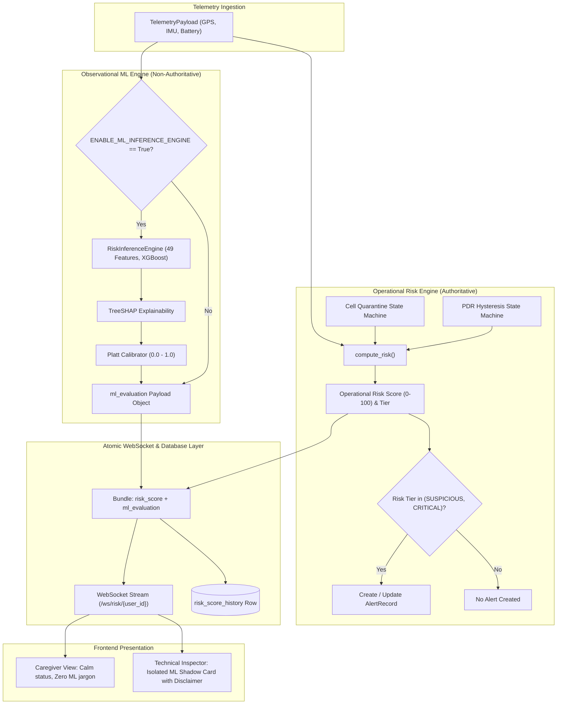

# Mobility Guardian — Phase 2 Handoff & Stabilization Guide

**Document Status:** Complete & Verified  
**Baseline Git Checkpoint:** `876683bba110f963a38231e137842d6587d76eec`  
**Standard Execution Mode:** Read-Only Runtime / Observational ML Shadow Mode  
**Scope:** Architecture state, verified test record, reproducible demonstration manual, and prioritized validation backlog.

---

## 1. Repository & Runtime State Inventory

### 1.1 Git Working Tree Baseline
- **Active Branch:** `main`
- **HEAD Commit:** `876683bba110f963a38231e137842d6587d76eec`
- **Working Tree Delta Summary:** 5 files modified (+211 lines, -26 lines), 9 untracked items preserved.

#### Modified Files Inventory
1. [`backend/app/routers/alerts.py`](file:///d:/repo-root/backend/app/routers/alerts.py):
   - **Delta:** Added `GET /api/alerts/user/{user_id}` and `GET /api/alerts?user_id=...` with user-scoping enforcement.
   - **Purpose:** Enables initial alert state hydration on page refresh, reconnect, or user switch, preventing cross-user alert leakage in the API.
2. [`frontend/src/App.jsx`](file:///d:/repo-root/frontend/src/App.jsx):
   - **Delta:** Added `fetchAlerts(targetUserId)` on connection with `AbortController` cancellation for user switches; merged persisted alerts with live WebSocket alerts.
   - **Purpose:** Prevents race conditions and restores pending/dismissed alert history upon browser reload.
3. [`frontend/src/components/AlertPanel.jsx`](file:///d:/repo-root/frontend/src/components/AlertPanel.jsx):
   - **Delta:** Implemented defensive fallback logic for `sensitivity_multiplier` and dismissal counts.
   - **Purpose:** Ensures dismissal quarantine indicators render reliably regardless of serialization naming differences.
4. [`frontend/src/components/caregiver/CaregiverDashboard.jsx`](file:///d:/repo-root/frontend/src/components/caregiver/CaregiverDashboard.jsx):
   - **Delta:** Partitioned alerts into active (`PENDING`) and historical (`DISMISSED_SAFE`); added syncing/error banner states.
   - **Purpose:** Prevents dismissed alerts from falsely inflating active threat badges while maintaining complete audit visibility.
5. [`ml/tests/test_inference_contract.py`](file:///d:/repo-root/ml/tests/test_inference_contract.py):
   - **Delta:** Wrapped verification of gitignored `risk_predictions.parquet` in `pytest.skip` if absent, while strictly enforcing SHA-256 validation of tracked benchmark reports (`predictive_risk_report.json` and `.md`).
   - **Purpose:** Allows test suite execution in fresh checkouts without requiring large, untracked training parquets.

#### Untracked Files Inventory
- [`.agents/`](file:///d:/repo-root/.agents/): Antigravity / Gravitas agent execution instructions and skills.
- [`backend/scripts/geolife_replay.py`](file:///d:/repo-root/backend/scripts/geolife_replay.py): CLI tool for replaying real-world GeoLife GPS trajectories against the ingestion endpoint.
- [`backend/tests/fixtures/`](file:///d:/repo-root/backend/tests/fixtures/): Test fixtures and sample trajectory data.
- [`backend/tests/test_alert_recovery.py`](file:///d:/repo-root/backend/tests/test_alert_recovery.py): Backend integration tests validating alert recovery and dismissal quarantine survival across restarts.
- [`backend/tests/test_geolife_replay.py`](file:///d:/repo-root/backend/tests/test_geolife_replay.py): Test suite validating trajectory parsing and replay timing.
- [`frontend/tests/test_alert_recovery.mjs`](file:///d:/repo-root/frontend/tests/test_alert_recovery.mjs): Playwright browser test verifying frontend state recovery and alert badge separation.
- [`ml/tests/conftest.py`](file:///d:/repo-root/ml/tests/conftest.py): ML test configuration and shared pytest fixtures.
- [`skills-lock.json`](file:///d:/repo-root/skills-lock.json): Agent system skill dependency lockfile.
- [`stitch-reference/`](file:///d:/repo-root/stitch-reference/): Reference UI designs and CSS design tokens from Stitch prototype.

### 1.2 Environment & Persistence Assets
- **Virtual Environment Backup:** [`backend/.venv.backup`](file:///d:/repo-root/backend/.venv.backup) verified intact (3,865 files, 70,084,998 bytes). Preserved as a clean pre-ML rollback point.
- **Development Database:** [`backend/app/data/app.db`](file:///d:/repo-root/backend/app/data/app.db) verified untouched at exact baseline (434,176 bytes; 13 consent, 2 dismissal quarantine, 4 PDR hysteresis, 2 alerts, 225 history records).
- **Demo / Isolated Test Database:** [`backend/app/data/demo_app.db`](file:///d:/repo-root/backend/app/data/demo_app.db) preserved (245,760 bytes; 5 consent records, 58 history records).
- **Port State:** Verified clean. Neither port `8000` (FastAPI) nor `5173` (Vite) is currently bound by running application processes.

---

## 2. Verification Record

### 2.1 Summary of Prior Phase Results
*(Note: The following outcomes represent historical results previously validated in Phases 2B.2 through 2D.1).*

- **Phase 2B.2 (Dependency Resolution & Runtime Validation):**
  - Successfully installed the 7 approved runtime packages into `backend/.venv`: `xgboost`, `scikit-learn`, `pandas`, `numpy`, `scipy`, `pyarrow`, `shap`.
  - PyTorch was explicitly excluded per contract.
  - Zero dependency conflicts confirmed via `pip check`.
- **Phase 2C (Controlled End-to-End Shadow Verification):**
  - Telemetry ingestion endpoint (`POST /api/telemetry/ingest`) verified to execute shadow inference when enabled.
  - Proved that operational risk scoring, risk tier assignment, and alert generation remain completely isolated from ML outputs.
- **Phase 2D (Controlled Local Dashboard Integration):**
  - Full-stack workflow validated using isolated database `demo_app.db`.
  - Telemetry streamed through WebSocket to React dashboard.
  - Desktop screenshots captured and validated:
    - Caregiver View: serene, non-technical, zero ML jargon.
    - Technical Inspector View: live TreeSHAP feature explanations and calibrated probability display.
- **Phase 2D.1 (Telemetry / UI Consistency Audit):**
  - Fully traced and reconciled all numerical metrics reported in Phase 2D:
    - Scores `45.78` / `36.78` and operational scores `51.3` / `17.5` mapped to user `sim_demo_1792089810` (Row IDs 38–43).
    - UI percentages `37.3%` / `11.7%` and operational score `55.9` mapped to user `sim_stage6` (Row IDs 57–58).
  - Confirmed that backend bundles operational risk and shadow ML into a single atomic payload, preventing cross-event desynchronization in the UI.

### 2.2 Previously Passing Test Suites & Commands
The following test suites were executed and reported as passing during Phase 2B.2 / 2C:

```bash
# 1. Dependency integrity check
backend/.venv/Scripts/python -m pip check
# Outcome: No broken requirements found.

# 2. Backend shadow inference integration suite (19 test items total)
backend/.venv/Scripts/python -m pytest backend/tests/test_shadow_inference.py
# Verified inventory: 19 passed

# 3. ML inference contract and benchmark verification suite (23 test items total)
backend/.venv/Scripts/python -m pytest ml/tests/test_inference_contract.py
# Verified inventory: 22 passed, 1 skipped (parquet)

# 4. GeoLife replay utility test suite (6 test items total)
backend/.venv/Scripts/python -m pytest backend/tests/test_geolife_replay.py
# Verified inventory: 6 passed

# 5. Alert recovery and persistence integration suite (4 test items total)
backend/.venv/Scripts/python -m pytest backend/tests/test_alert_recovery.py
# Verified inventory: 4 passed
```

> [!NOTE]
> **Test Inventory Reconciliation:** The 52 test items across these four test suites represent the verified test inventory confirmed via `pytest --collect-only`. Earlier phase draft notes cited inflated counts (e.g. 25, 28, 10, 3) caused by conflating test functions with sub-assertions, failure counts, or parametrization permutations. The numbers above reflect the actual, source-grounded test items.

#### Skipped Test Rationale
- `ml/tests/test_inference_contract.py::test_no_fabricated_geolife_labels_or_hash_drift`: Skips execution **only** when `ml/data/processed/risk_predictions.parquet` is absent. This file is gitignored due to size. The test still validates SHA-256 hashes for tracked reports:
  - `predictive_risk_report.json`: `c7b57bdff9c126c382f5e535b376df101d432daa0da2a3c064c424f95bafced1`
  - `predictive_risk_report.md`: `181c2b108b1f4f8fc044e63f4cdd70e0447726925bf120da6818c9db945df0da`

---

## 3. Machine Learning Architecture & Safety Boundaries

### 3.1 Locked Prediction Horizons
The predictive XGBoost models operate strictly across four window-harmonic horizons serialized in `ml/models/xgboost/`:
1. **120s (2m Micro):** Immediate short-term kinematic instability.
2. **360s (6m Operational Short):** Early-warning trajectory divergence.
3. **600s (10m Medium):** Mid-range route-level departure risk.
4. **840s (14m Operational Extended):** Long-range corridor breach excursion.

> [!WARNING]
> Any request specifying `horizon_sec=300` is invalid and explicitly rejected by the inference engine with `ValueError`. 300s is an inactivity timeout in trajectory preprocessing, not an inference horizon.

### 3.2 49-Feature Kinematic Model Configuration
All models evaluate a strictly ordered 49-feature schema defined in `model_metadata.json`:
- **Raw Window Kinematics (13 features):** `mean_speed_mps`, `speed_std_dev`, `path_distance_m`, `straight_line_displacement_m`, `tortuosity_index`, `entropy_directional`, `turn_frequency`, `loop_metric`, `pacing_tendency`, `backtracking_tendency`, `heading_variability`, `point_count`, `temporal_span_sec`.
- **Kinematic Deltas (5 features):** `delta_mean_speed_mps`, `delta_entropy_directional`, `delta_turn_frequency`, `delta_loop_metric`, `delta_pacing_tendency`.
- **Personal Dispersion Normalized Features (24 features):** 8 core metrics evaluated across 3 statistical baselines ($Z_{\text{MAD}}$, ratio to median $\tilde{x}$, and 95th percentile exceedance flag $I(x > P_{95})$):
  - `mean_speed_mps`, `tortuosity_index`, `entropy_directional`, `turn_frequency`, `loop_metric`, `pacing_tendency`, `straight_line_displacement_m`, `path_distance_m`.
- **Aggregate Dispersion Statistics (2 features):** `max_mad_z_score`, `p95_exceedance_count`.
- **Temporal & Lifecycle Context (5 features):** `hour_of_day`, `day_of_week`, `is_weekend`, `trip_index`, `is_cold_start`.

### 3.3 Operational vs Shadow ML Safety Boundary



- **Authoritative Decisions:** Operational risk (`risk_score`, `risk_tier`, `polling_instruction`) is calculated **exclusively** by deterministic algorithms in `app.services.mock_risk_engine`.
- **Alert Triggering:** Alert records are generated **only** when `risk_output.risk_tier` enters `SUSPICIOUS` or `CRITICAL`. The ML prediction `trigger_state.binary_alert` has **zero authority** over alerts.
- **Shadow Mode Guard:** ML inference is executed asynchronously only when `ENABLE_ML_INFERENCE_ENGINE=true`. Failures in ML do not impede or delay operational risk output.
- **Frontend Isolation:**
  - **Caregiver View:** Completely hides raw probabilities, TreeSHAP scores, and model names. Presents reassuring, plain-language summaries (e.g., "Normal Movement Pace", "No Active Alerts Recorded").
  - **Technical Inspector View:** Displays ML metrics in a dedicated section marked `🔬 Observational ML Evaluation (Shadow Mode)` accompanied by an explicit disclaimer: *"Observational ML evaluation only — not a clinical prediction, diagnosis, or operational safety decision."*

---

## 4. Known System Limitations & Constraints

1. **Synthetic-to-Real Domain Gap:**
   - Training and validation datasets rely on synthetically injected Algase wandering phenotypes (Lapping, Pacing, Random Drift) overlaid on public GeoLife trajectories.
   - Real-world behavioral patterns among cognitively impaired individuals exhibit higher variance and idiosyncratic routines.
2. **Absence of Clinical Validation:**
   - The platform has not undergone clinical trials, IRB review, or FDA/CE-mark software-as-a-medical-device (SaMD) clearance.
   - Predictions must not be used as clinical diagnostic indicators or life-critical safety triggers.
3. **Missing Authentication and Authorization:**
   - `/api/*` REST endpoints and `/ws/*` WebSocket streams currently enforce **no authentication** (no JWT, session tokens, or API keys).
   - Any client can supply an arbitrary `user_id` to query history or ingest telemetry. The newly added user-scoping query parameters prevent casual cross-user leakage but provide **no cryptographic access control**.
4. **PDR IMU Drift Under Extended GPS Loss:**
   - Pedestrian Dead Reckoning (PDR) uses uncalibrated phone-grade accelerometer/gyroscope integration. During extended GPS outages (>10–15 minutes), accumulated drift can exceed the Tier 2 threshold (50m displacement).
5. **Low-Battery Pulse Latency:**
   - In battery-saving pulse mode, the device sleeps for up to 175 seconds between 5-second sampling bursts. An excursion occurring immediately after a burst ends will not be detected until the next wake cycle.

---

## 5. Reproducible Local Demonstration Manual

Follow this procedure to run an isolated, end-to-end demonstration without risking development database corruption.

### 5.1 Environment Prerequisites
- Windows 10/11 or Linux/macOS
- Python 3.12 with `backend/.venv` (containing the 7 approved ML packages)
- Node.js 18+ and npm installed

### 5.2 Step-by-Step Launch Procedure

#### Step A: Configure Isolated Demo Environment & Launch Backend
To preserve `backend/app/data/app.db`, point the backend to the verified isolated test database `demo_app.db` and enable shadow ML.

> [!IMPORTANT]
> **Working Directory Sensitivity:** In [`backend/app/db.py`](file:///d:/repo-root/backend/app/db.py), the database path is evaluated as `Path(os.getenv("DATABASE_PATH", str(_DATA_DIR / "app.db")))`. When given a relative path like `app/data/demo_app.db`, it resolves relative to the current working directory of the process. Therefore, either navigate to `backend/` *before* setting the relative path, or use an absolute path (`$PWD/...`) to guarantee the server connects to `demo_app.db` rather than creating an unintended database in the repo root or defaulting to `app.db`.

**Recommended: Launch from `backend/` directory:**

*PowerShell:*
```powershell
cd backend
$env:DATABASE_PATH = "app/data/demo_app.db"
$env:ENABLE_ML_INFERENCE_ENGINE = "true"
.venv\Scripts\uvicorn app.main:app --reload --host 127.0.0.1 --port 8000
```

*Bash / Git Bash:*
```bash
cd backend
export DATABASE_PATH="app/data/demo_app.db"
export ENABLE_ML_INFERENCE_ENGINE="true"
source .venv/bin/activate && uvicorn app.main:app --reload --host 127.0.0.1 --port 8000
```

**Alternative: Launch from Repository Root (CWD-Independent Path):**

*PowerShell:*
```powershell
$env:DATABASE_PATH = "$PWD/backend/app/data/demo_app.db"
$env:ENABLE_ML_INFERENCE_ENGINE = "true"
backend\.venv\Scripts\uvicorn backend.app.main:app --reload --host 127.0.0.1 --port 8000
```

Verify health check: Open `http://127.0.0.1:8000/health` in a browser or terminal (expected: `{"status":"ok"}`).

#### Step B: Start Frontend Dashboard
In a second terminal window, navigate to `frontend/`:
```bash
cd frontend
npm run dev
```
Open `http://localhost:5173` in your browser.

#### Step C: Connect Dashboard
1. The dashboard defaults to User ID: `sim_stage6`.
2. Click **Connect** (or ensure connection status displays green `RISK WS: OPEN` and `ALERTS WS: OPEN`).
3. Notice that `sim_stage6` has prior test records loaded and displays `0 active alerts` (with historical records noted).

#### Step D: Feed Synthetic Telemetry
In a third terminal window (from repository root), use the trajectory simulator to stream points into the running backend.

> [!CAUTION]
> **Database Protection Gate:** The trajectory simulator transmits HTTP requests to `/api/consent/record` and `/api/telemetry/ingest`, causing the backend to write to its currently active database. Always confirm the backend server was started with `DATABASE_PATH` pointing to `demo_app.db` before running the simulator. Never run the simulator against a backend connected to `backend/app/data/app.db`.

```bash
# Stream 10 points along a normal trajectory
python backend/scripts/trajectory_simulator.py \
    --user-id sim_stage6 \
    --pattern normal \
    --anchor-lat 39.9830 \
    --anchor-lng 116.3130 \
    --num-points 10 \
    --interval-seconds 1.0 \
    --backend-url http://127.0.0.1:8000
```

#### Step E: Observe Both Dashboard Views
1. **Caregiver View (Default):**
   - Click **🛡️ Caregiver View** in the top navigation.
   - Note the serene aesthetic, large status cards, and plain-English indicators (`Normal Movement Pace`, `Stationary`, `No Active Alerts Recorded`).
   - Notice the complete absence of ML jargon, probability percentages, or model names.
2. **Technical Inspector View:**
   - Click **🔬 Technical Inspector** in the top navigation.
   - Note the real-time operational risk score card (`55.9 / 100`).
   - Locate the **🔬 Observational ML Evaluation (Shadow Mode)** container:
     - Verify status pill displays `Window Evaluated`.
     - Verify Kinematic Outlier Probability is displayed (e.g., `37.3%`).
     - Inspect the TreeSHAP feature attribution list showing which kinematic dimensions contributed to the prediction.
     - Review the prominent disclaimer at the card footer.

#### Step F: Clean Shutdown
1. Stop the simulator terminal with `Ctrl+C` (if still running).
2. Stop the frontend Vite dev server with `Ctrl+C`.
3. Stop the backend Uvicorn server with `Ctrl+C`.
4. Verify no lingering processes hold ports `8000` or `5173`:
   ```powershell
   Get-NetTCPConnection -LocalPort 8000, 5173 -ErrorAction SilentlyContinue
   ```

---

## 6. Prioritized Future Validation Backlog

The following backlog categorizes confirmed defects, unverified operational risks, and proposed future engineering tasks for subsequent phases.

```mermaid
graph TD
    classDef defect fill:#fee2e2,stroke:#ef4444,stroke-width:2px;
    classDef risk fill:#fef3c7,stroke:#f59e0b,stroke-width:2px;
    classDef future fill:#e0f2fe,stroke:#0284c7,stroke-width:2px;

    D1["1. Missing API Auth & Token Verification"]:::defect
    R1["2. WebSocket Flutter & Reconnect Edge Cases"]:::risk
    R2["3. Multi-User Simulator Concurrency Collisions"]:::risk
    R3["4. PDR Long-Dwell Drift False Triggers"]:::risk
    R4["5. Battery Pulse Sparse Sampling Latency"]:::risk
    F1["6. Extended Algase Trajectory Replay Suite"]:::future
    F2["7. Continuous TreeSHAP Background Attribution Benchmark"]:::future
    F3["8. Clinical Protocol & IRB Preflight"]:::future
```



### Priority 1: Trajectory Scenario Coverage
- **Type:** Proposed Engineering Work
- **Tasks:**
  - Build automated end-to-end replay pipelines for all three Algase wandering phenotypes: *Lapping* (circular loops $R < 100$m), *Pacing* (back-and-forth along linear segments), and *Random Drift* (progressive outward displacement).
  - Benchmark detection lead-time differences across the 4 horizons (120s vs 360s vs 600s vs 840s).

### Priority 2: GPS Degradation & Telemetry Interruption / Recovery
- **Type:** Unverified Risk & Engineering Work
- **Tasks:**
  - Stress-test the transition from `VALID_SIGNAL` to `DEGRADED_SIGNAL` with missing or noisy IMU displacement.
  - Verify that the PDR state machine correctly resets hysteresis counters upon GPS signal reacquisition without generating spurious breach alerts.

### Priority 3: WebSocket Reconnection & Alert Edge-Case Hardening
- **Type:** Unverified Risk / Edge-Case Hardening (Reclassified from Defect)
- **Current Architecture & Evidence:** Client-side deduplication is already implemented in [`frontend/src/App.jsx`](file:///d:/repo-root/frontend/src/App.jsx): lines 141–150 update existing alerts by `alert_id` in WebSocket `onmessage`, and lines 243–262 seed a deduplicating `new Map()` on `alert.alert_id` in `fetchAlerts()`. Furthermore, unit tests in [`frontend/tests/test_alert_recovery.mjs`](file:///d:/repo-root/frontend/tests/test_alert_recovery.mjs) explicitly assert that snapshot and WebSocket alerts merge without duplicate alert cards. No failing test or reproducible duplicate-card defect currently exists.
- **Future Hardening Tasks:**
  - Stress-test rapid flutter disconnect/reconnect cycles under high alert frequency.
  - Ensure alert state transitions occurring during transient disconnects (e.g. `PENDING` $\rightarrow$ `DISMISSED_SAFE`) render smoothly without visual flicker.

### Priority 4: Multi-User Concurrency & State Isolation
- **Type:** Unverified Operational Risk
- **Tasks:**
  - Stress-test the backend with 50 concurrent simulated users streaming telemetry simultaneously.
  - Audit thread-safety and lock contention in `backend/app/services/inference_service.py` (`_user_locks` and `_thread_locks_guard`).
  - Verify zero cross-talk between user sliding windows and personal baselines.

### Priority 5: API Authentication, Authorization & Consent Enforcement
- **Type:** Confirmed Architectural Defect (Security)
- **Tasks:**
  - Implement token-based authentication (JWT / OAuth2 bearer tokens) for all `/api/*` routes and WebSocket connection upgrade headers.
  - Enforce role-based access control (RBAC): Caregivers can only access patients for whom they hold an active guardian consent record.
  - Add cryptographic signature verification to consent grant records.

### Priority 6: Model Evaluation Limitations & Explainability Correctness
- **Type:** Proposed Engineering Work
- **Tasks:**
  - Formally benchmark TreeSHAP computational latency on constrained CPU hosts to guarantee explanation generation finishes within the 120s sliding window interval.
  - Investigate background drift in user mobility baselines when an individual permanently relocates or changes daily routines.
