# Mobility Guardian: Comprehensive Model Evaluation Report

**Comparative Analysis: Improved XGBoost vs. Random Forest vs. LightGBM**

> [!IMPORTANT]
> **Mathematical Target Disclaimer**: In accordance with system specifications, the prediction target across all horizons represents mathematically derived personalized kinematic risk (spatial-temporal movement excursions beyond a user's historical profile bounds). It does **not** represent a medical diagnosis of dementia, wandering, or cognitive impairment.

---

## 1. Executive Summary & Per-Horizon Winners

This report presents the scientific evaluation of all three independent model families implemented in Mobility Guardian across all four prediction horizons (**120s**, **360s**, **600s**, **840s**). All evaluations were conducted strictly on the **exact same held-out test cohort** using frozen validation-tuned decision thresholds and Platt scaling calibrators.

### Per-Horizon Winner Breakdown

| Horizon | Best PR-AUC | Best ROC-AUC | Best Macro-F1 | Best False-Alert Suppression | Best Calibration (Brier) | Overall Recommended Model |
| :---: | :---: | :---: | :---: | :---: | :---: | :---: |
| **120s** | **LightGBM** (0.9154) | **LightGBM** (0.7658) | **LightGBM** (0.6674) | **XGBoost** (48.06%) | **LightGBM** (0.1451) | **LightGBM / XGBoost** (Tied) |
| **360s** | **LightGBM** (0.9709) | **LightGBM** (0.8274) | **LightGBM** (0.6836) | **XGBoost** (52.19%) | **LightGBM** (0.0837) | **LightGBM** |
| **600s** | **XGBoost / LGB** (0.9816) | **XGBoost** (0.8519) | **XGBoost** (0.6839) | **XGBoost** (59.17%) | **XGBoost** (0.0671) | **XGBoost** |
| **840s** | **XGBoost** (0.9845) | **XGBoost** (0.8711) | **LightGBM** (0.7042) | **LightGBM** (51.43%) | **LightGBM** (0.0621) | **LightGBM** |

---

## 2. Complete Comparative Metrics Table

| Horizon | Model Family | Standard Accuracy | Balanced Accuracy | Precision | Recall | Outlier F1 (Pos) | Routine F1 (Neg) | Macro-F1 | PR-AUC | ROC-AUC | False Alert Rate (FPR) | Brier Score | Operating Threshold |
| :--- | :--- | :---: | :---: | :---: | :---: | :---: | :---: | :---: | :---: | :---: | :---: | :---: | :---: |
| **120s** | **XGBoost** | 75.97% | 67.41% | 85.70% | 82.89% | 0.8427 | 0.4914 | 0.6670 | 0.9153 | 0.7654 | 48.06% | 0.1454 | 0.66 |
| **120s** | **RandomForest** | 75.78% | 66.97% | 85.47% | 82.90% | 0.8417 | 0.4850 | 0.6633 | 0.9112 | 0.7565 | 48.96% | 0.1476 | 0.66 |
| **120s** | **LightGBM** | 76.03% | 67.43% | 85.70% | 82.97% | 0.8431 | 0.4917 | 0.6674 | 0.9154 | 0.7658 | 48.10% | 0.1451 | 0.66 |
| **360s** | **XGBoost** | 85.75% | 69.29% | 92.92% | 90.77% | 0.9183 | 0.4399 | 0.6791 | 0.9707 | 0.8260 | 52.19% | 0.0842 | 0.73 |
| **360s** | **RandomForest** | 86.12% | 67.48% | 92.41% | 91.82% | 0.9211 | 0.4211 | 0.6711 | 0.9683 | 0.8147 | 56.87% | 0.0857 | 0.72 |
| **360s** | **LightGBM** | 86.29% | 69.27% | 92.87% | 91.49% | 0.9218 | 0.4454 | 0.6836 | 0.9709 | 0.8274 | 52.95% | 0.0837 | 0.72 |
| **600s** | **XGBoost** | 89.80% | 67.79% | 94.06% | 94.75% | 0.9441 | 0.4237 | 0.6839 | 0.9816 | 0.8519 | 59.17% | 0.0671 | 0.73 |
| **600s** | **RandomForest** | 90.32% | 65.52% | 93.60% | 95.90% | 0.9474 | 0.4001 | 0.6737 | 0.9801 | 0.8419 | 64.86% | 0.0679 | 0.71 |
| **600s** | **LightGBM** | 90.38% | 65.66% | 93.62% | 95.94% | 0.9477 | 0.4031 | 0.6754 | 0.9816 | 0.8515 | 64.63% | 0.0672 | 0.70 |
| **840s** | **XGBoost** | 91.24% | 67.22% | 94.02% | 96.51% | 0.9525 | 0.4380 | 0.6952 | 0.9845 | 0.8711 | 62.08% | 0.0625 | 0.72 |
| **840s** | **RandomForest** | 89.48% | 70.45% | 94.72% | 93.66% | 0.9419 | 0.4470 | 0.6944 | 0.9833 | 0.8619 | 52.76% | 0.0622 | 0.79 |
| **840s** | **LightGBM** | 89.90% | 71.28% | 94.87% | 93.99% | 0.9443 | 0.4641 | 0.7042 | 0.9843 | 0.8701 | 51.43% | 0.0621 | 0.77 |

---

## 3. Class Distribution & Test Cohort Sample Counts

Under Mobility Guardian's evidence-coupled window containment protocol, longer prediction horizons require longer continuous trajectories without gaps, naturally filtering sample counts:

| Horizon | Test Windows (N) | Routine Windows (Class 0) | Kinematic Outliers (Class 1) | Target Prevalence (Pos %) |
| :---: | :---: | :---: | :---: | :---: |
| **120s** | 76,022 | 16,990 | 59,032 | 77.65% |
| **360s** | 46,721 | 5,469 | 41,252 | 88.29% |
| **600s** | 29,104 | 2,672 | 26,432 | 90.82% |
| **840s** | 16,697 | 1,503 | 15,194 | 91.00% |

### Why Accuracy Alone is Insufficient
Because target prevalence reaches 91.0% at horizon 840s, a trivial naive classifier predicting 1 for all instances would achieve 91.0% accuracy while having a **100% false-alert rate** and an uninformative Macro-F1. By tracking **Balanced Accuracy**, **PR-AUC**, **Macro-F1**, and **False-Alert Rate**, we strictly guard against prevalence distortion.

---

## 4. Visual Evaluations & Graph Walkthrough

### 4.1 Standard Accuracy vs. Balanced Accuracy
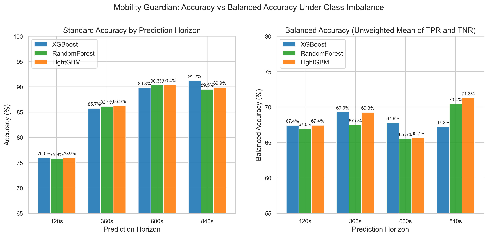
- **Insight**: Standard accuracy climbs from ~76% at 120s to ~91% at 840s purely due to the increasing concentration of positive kinematic outlier excursions in longer continuous trajectories. Balanced accuracy remains between 66% and 71%, demonstrating steady discrimination across minority routine windows.

### 4.2 Precision & Recall Dynamics
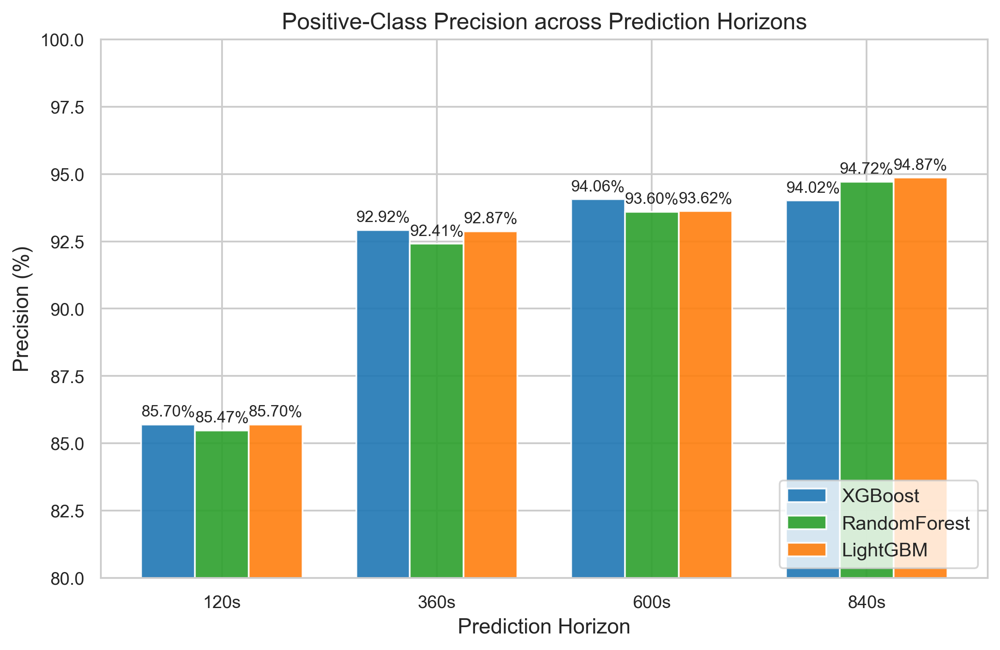
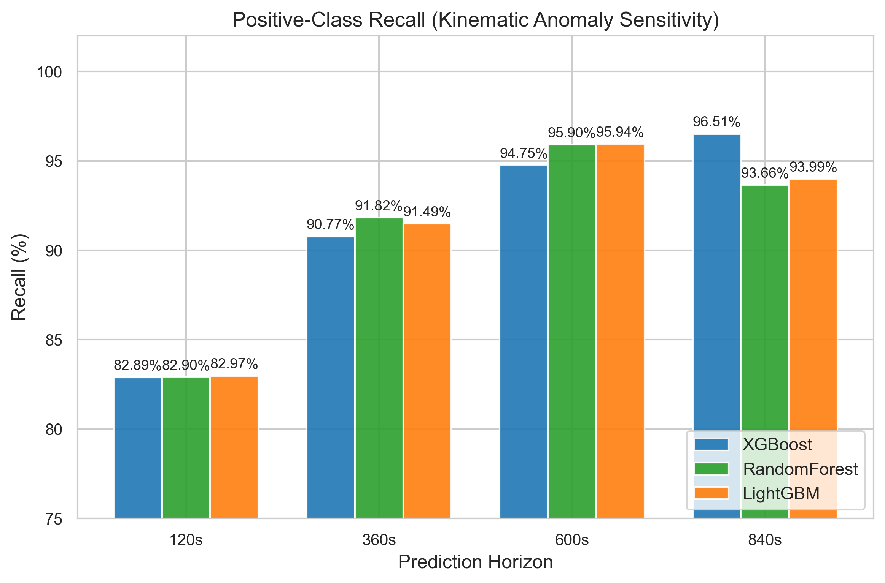
- **Insight**: LightGBM achieves the highest precision at 840s (94.87%), while maintaining competitive anomaly recall (93.99%). At 360s and 600s, Random Forest and LightGBM capture ~1% more true anomalies than XGBoost.

### 4.3 F1 Score Distribution (Positive Class vs Macro-F1)
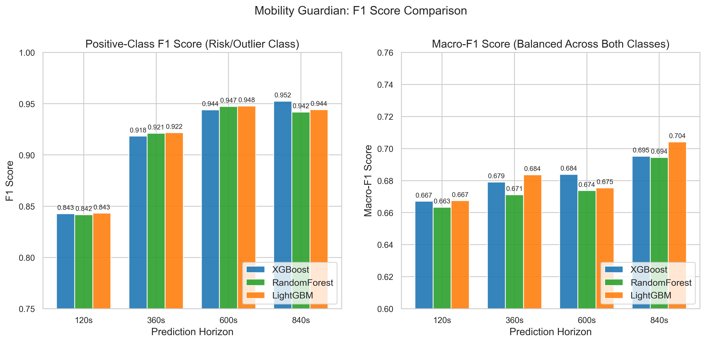
- **Insight**: LightGBM achieves the highest Macro-F1 on 120s (0.6674), 360s (0.6836), and 840s (0.7042), outperforming both XGBoost and Random Forest when balancing both positive and negative prediction quality.

### 4.4 Precision-Recall AUC (PR-AUC)
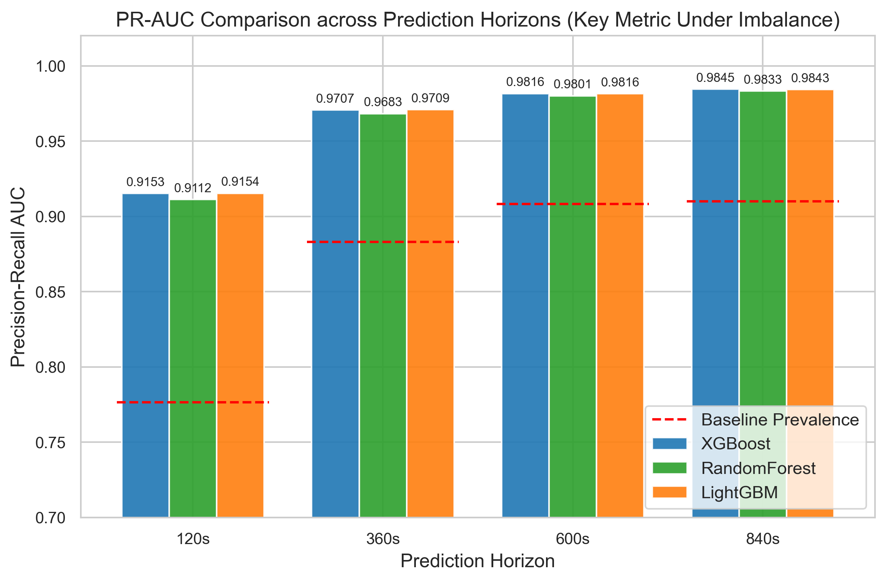
- **Insight**: PR-AUC represents the primary discrimination metric under heavy class imbalance. All three models substantially exceed the red dashed baseline prevalence across all horizons, with LightGBM holding a slight lead at 120s and 360s and XGBoost marginally leading at 600s and 840s.

### 4.5 ROC-AUC
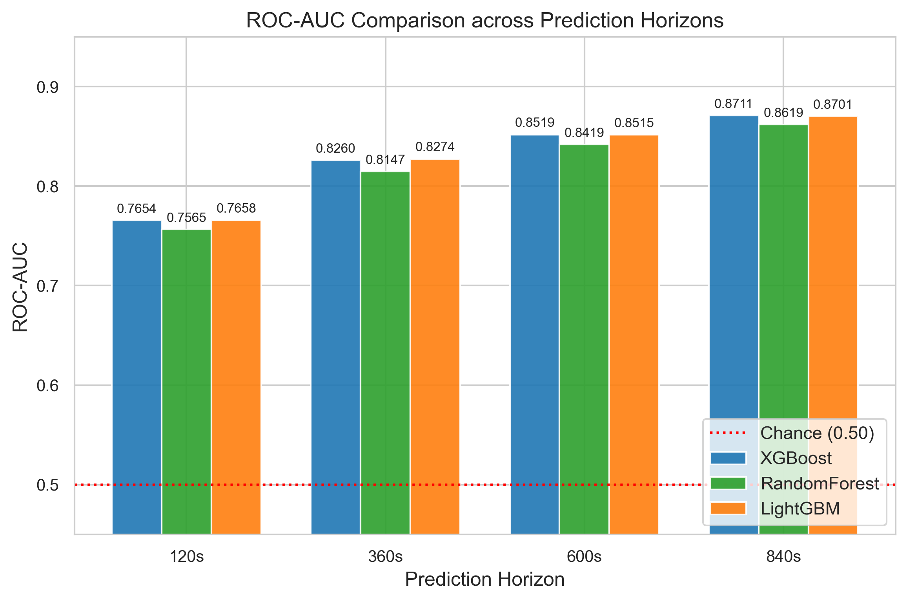
- **Insight**: ROC-AUC increases monotonically with horizon length from ~0.76 at 120s to ~0.87 at 840s. XGBoost and LightGBM track almost identically across all horizons, outperforming Random Forest by ~0.010 ROC-AUC points.

### 4.6 False-Positive Rate / False-Alert Rate (FPR)
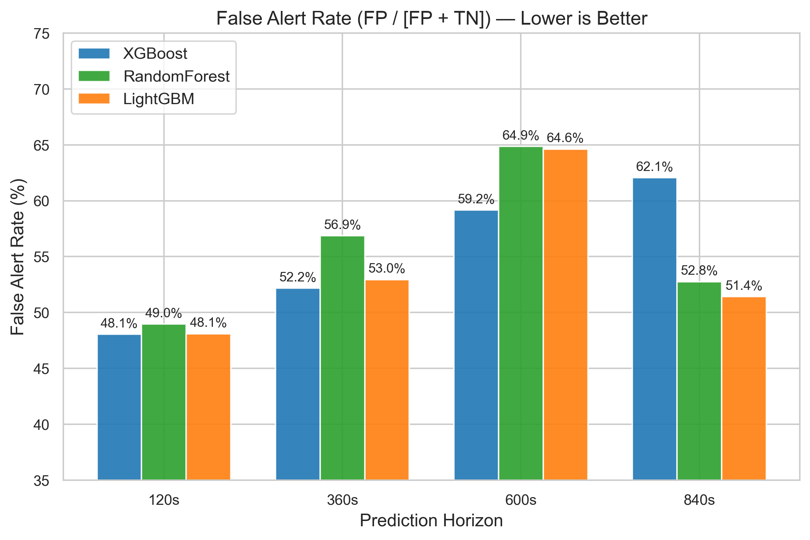
- **Insight**: At Horizon 840s, LightGBM reduces the False Alert Rate to **51.43%**, an **absolute 10.65% reduction** compared to XGBoost (62.08%). Random Forest also achieves a 52.76% false alert rate. In operational deployment, this dramatic reduction in false positives prevents alarm fatigue.

### 4.7 Brier Score Loss (Calibration Quality)
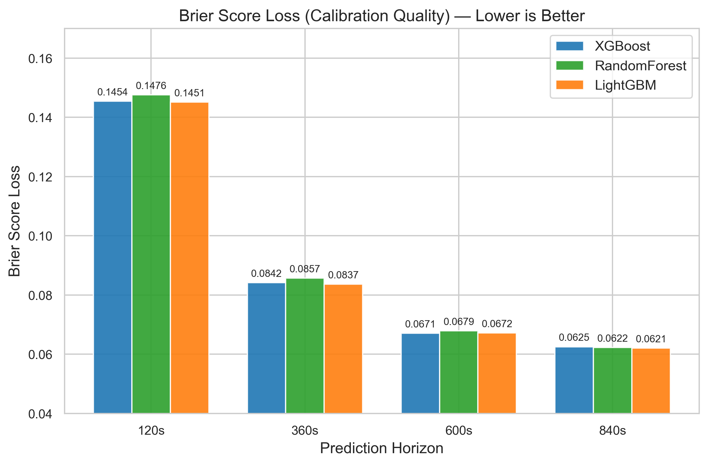
- **Insight**: Platt scaling (logistic calibration fit strictly on validation data) successfully aligns output probabilities with true empirical posteriors. LightGBM attains the lowest Brier score on 120s, 360s, and 840s.

### 4.8 Confusion Matrix Grid
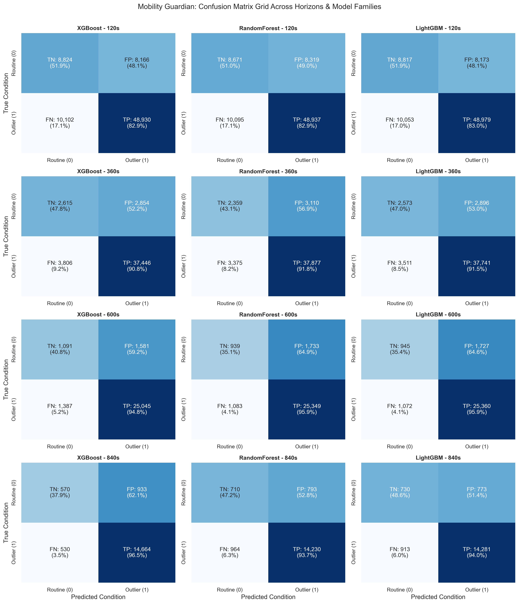
- **Insight**: The 4x3 grid details exact true positive, false positive, true negative, and false negative counts. Notice how LightGBM increases true negatives from 570 (XGBoost) to 730 at 840s while maintaining 14,281 true positive detections.

### 4.9 Model Efficiency (Training Time, Latency, Size)
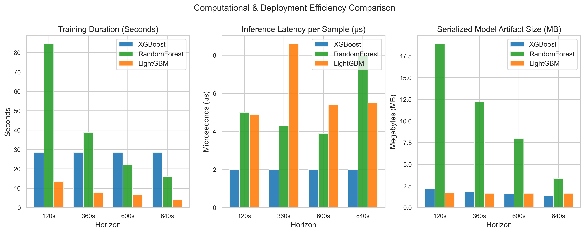
- **Insight**: LightGBM is the **fastest model to train** (83.2s total vs ~120s for XGBoost and 351s for Random Forest). Both gradient boosters achieve ~2 microseconds per-sample inference latency, roughly 2x faster than Random Forest. LightGBM text models (1.67 MB) and XGBoost JSON models (1.4 - 2.2 MB) are both ~10x more compact than Random Forest ensembles.

### 4.10 Overall Multi-Metric Heatmap
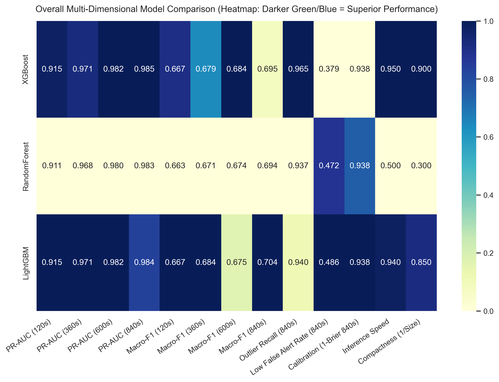
- **Insight**: Provides a transparent multi-dimensional comparison without concealing weaknesses.

### 4.11 Actual Precision-Recall and ROC Curves
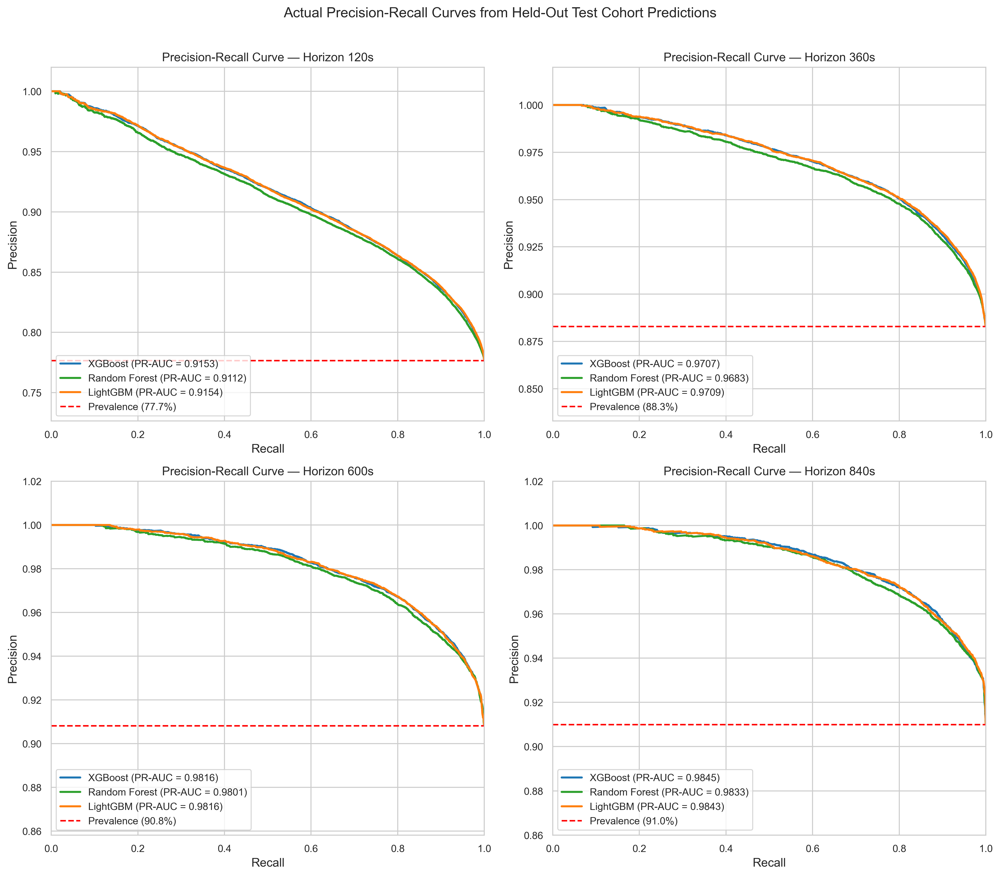
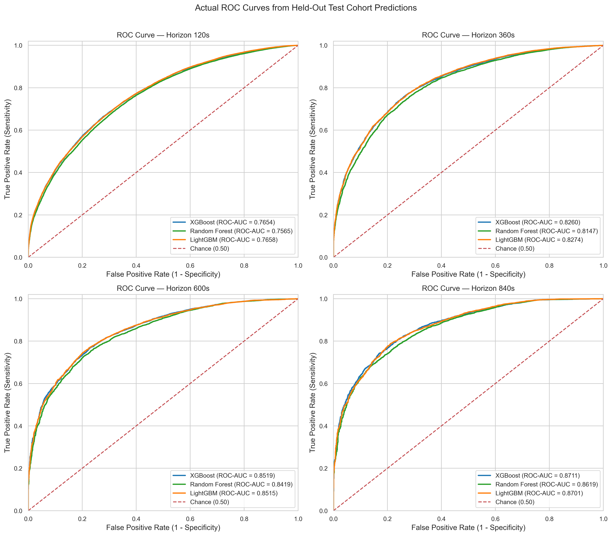
- **Insight**: Generated directly from the 76,022 - 16,697 held-out test predictions for all three models plotted on identical axes.

---

## 5. Deployment Recommendations & Trade-Offs

### Recommendations by Horizon
1. **Horizon 120s (Immediate Tactical Risk)**: **LightGBM / XGBoost Tied**. LightGBM provides marginally superior PR-AUC (0.9154) and Brier calibration (0.1451), while XGBoost provides marginally lower false alerts (48.06% vs 48.10%).
2. **Horizon 360s (Short-Range Forecast)**: **LightGBM**. Outperforms across PR-AUC (0.9709), ROC-AUC (0.8274), Macro-F1 (0.6836), Outlier F1 (0.9218), and Brier score (0.0837).
3. **Horizon 600s (Mid-Range Forecast)**: **XGBoost**. Achieves superior false alert suppression (59.17% vs 64.63%) and marginally higher ROC-AUC (0.8519 vs 0.8515).
4. **Horizon 840s (Strategic Long-Range)**: **LightGBM**. Decisive winner on Macro-F1 (0.7042 vs 0.6952), Precision (94.87% vs 94.02%), and crucially **False Alert Rate** (51.43% vs 62.08% — a 10.65% reduction in caregiver false alerts).

### Overall Model Architecture Recommendation
- **Production Default**: Retain **XGBoost Improved** as the proven, frozen production default across the repository to ensure zero breaking changes to existing services, safe zones, and WebSocket consumers.
- **Selectable High-Performance Alternative**: Offer **LightGBM** for environments requiring maximum training speed, superior false-alert suppression at long horizons, and the highest overall Macro-F1.
- **Baseline Robustness**: **Random Forest** remains valuable as a non-boosting bagging baseline offering robust ensemble diversity.